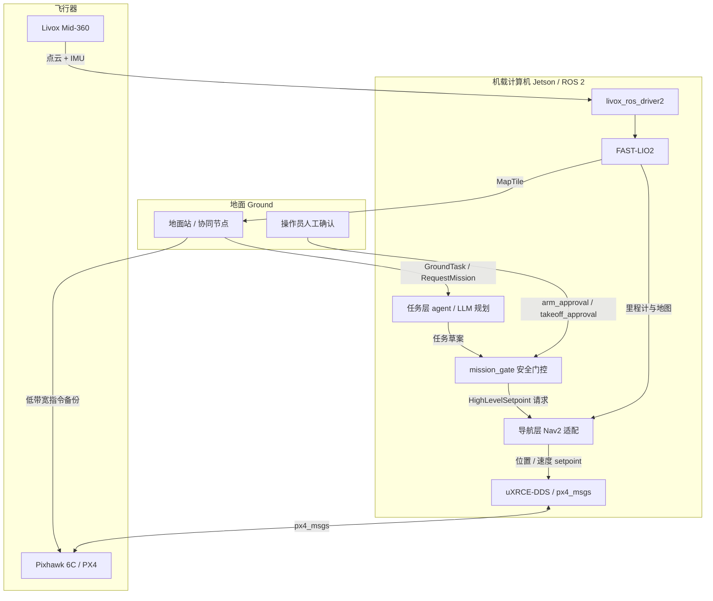

# 蜂鸟架构分层 Architecture

本文档由 Grok 撰写/协助；2026-11-11 由 Claude 补充了实现状态。

本文描述计划中的软件分层，以及层与层之间允许出现的数据流。这是设计说明，**不是**已在 Pixhawk 6C / Jetson / Mid-360 实机上跑通的实现记录。Ryan 的原工程代码已丢失，重建代码建议放入 [`../src/`](../src/) 或 `ryan-rebuild` 分支，再对照本图对齐话题名。

## 实现状态（`ryan-rebuild` 分支，2026-11-11）

| 层 | 状态 |
| --- | --- |
| 飞控 | PX4 v1.16.1（团队已刷、已试飞）。Jetson↔Pixhawk 的数据线**还没接** |
| 感知 | 驱动与 FAST-LIO2 的启动和配置已写好，用假 Mid-360 在仿真里跑通；真机上团队已做过手持和机载建图 |
| 建图 | `map_recorder`（体素地图、自动保存）和 `map_tiler`（`MapTile` 高度分块）已实现并在仿真里验证 |
| LIO → PX4 | `hummingbird_px4_bridge` 已实现，对照 PX4 v1.16.1 源码核对过；**没有在 PX4 SITL 或真机上验证** |
| 导航 | **没有实现**。没有任何节点把 `HighLevelSetpoint` 变成 PX4 的 setpoint |
| 任务 / Agent | `mission_gate` 已实现（服务、GroundTask 草案 + 人工批准、geofence）；LLM 规划器没有实现 |

## 分层

1. **飞控层 Flight control**：Pixhawk 6C 上的 **PX4**。姿态、位置回路、解锁、起飞、故障保护在这一层闭环。机载计算机通过 **uXRCE-DDS** 与 PX4 交换 `px4_msgs`。ROS 2 侧只发送高层位置 / 速度 setpoint 或任务请求，不直接写电机 PWM 或混控输出。
2. **感知层 Perception**：**Livox Mid-360** → `livox_ros_driver2`（依赖 Livox-SDK2）输出点云与 IMU；**FAST-LIO2**（`FAST_LIO_ROS2`）做激光惯性里程计。
3. **建图层 Mapping**：FAST-LIO2 维护的局部 / 全局地图；空地协同时切成 `MapTile` 下发，而不是默认把完整稠密点云推到地面站。
4. **导航层 Navigation**：在 LIO 位姿与地图上做路径规划与跟踪。计划复用 **Nav2** 的规划 / 控制思路，但空中平台必须叠加 geofence、高度通道和 PX4 自身的 failsafe；Nav2 默认是地面移动机器人，接入方式还需要单独适配，本文不假装已经接好。
5. **任务 / Agent 层 Task / agent**：规划「去哪、测绘哪一块、何时返航」等任务。大模型或 agent **只产出高层任务**；必须经过 `mission_gate` 校验（geofence、人工确认解锁 / 起飞）后，才能以 `HighLevelSetpoint` 的形式向下发送。**Agent 不得直接发送执行器指令。**

## 数据流（mermaid）

## 坐标系约定（必须显式转换）

- ROS 2 / Nav2 / 常见 SLAM：默认 **ENU** 世界系、**FLU** 机体轴（前-左-上）。
- PX4 / 飞控：常用 **NED** 世界系、**FRD** 机体轴（前-右-下）。

两套约定不能直接互发位置向量。桥接节点需要固定的 ENU↔NED 变换，并在每个 `HighLevelSetpoint` 与地图消息里写清 `frame_id`。FAST-LIO2 的 `camera_init` / `body` 到 PX4 外部视觉输入（`POSE_FRAME_FRD`）的换算已在 `hummingbird_px4_bridge` 里实现，见 [ryan-rebuild.md](ryan-rebuild.md) 的"坐标系"一节；反方向（把 `hummingbird_map` 里的航点换到 PX4 本地坐标系）属于还没实现的导航层。

## 安全边界

| 允许进入下一层的内容 | 不允许越过门控的内容 |
| --- | --- |
| 任务类型、航点、测绘区域、返航请求 | 电机 / 舵机 PWM、混控输出、`actuator_*` 话题 |
| 经门控的高层位置 / 速度 setpoint | 未带 `arm_approval` 的解锁请求 |
| 状态、电量、位姿、MapTile 回传 | 未带 `takeoff_approval` 的起飞 |

详见 [task-agent-design.md](task-agent-design.md)。
