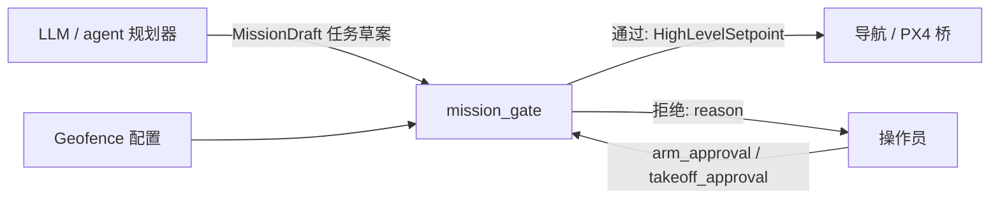

# 任务层 Agent 设计 Task / Agent Layer

任务层把「去测绘这个区域并回来」这类自然语言或地面任务，变成可执行、可拒绝的高层任务。它是规划器，**不是**飞控。

Ryan 原代码已丢失；本文件与 `hummingbird_task_agent` 都是全新草图，未在硬件上验证。

## 职责划分

- **LLM / agent**：解释地面任务、提出航点或区域、标注任务类型（探索、测绘、观察、悬停、返航、降落）。可以建议「需要解锁才能执行」，但**不能自己把批准位置为 true**。
- **mission_gate**：检查 geofence、任务完整性、以及解锁 / 起飞的显式人工批准。通过后只发布 `HighLevelSetpoint`。
- **导航与 PX4**：跟踪已放行的 setpoint，并执行 PX4 自己的 failsafe。

## 硬性安全规则

1. **Agent 不得直接发送执行器指令。** 禁止发布或调用：电机 / 舵机 PWM、混控输出、`actuator_motors` / `actuator_servos` 一类话题、绕过 PX4 的 OFFBOARD 直接改执行器、以及任何「未经过门控的」`VEHICLE_CMD_COMPONENT_ARM_DISARM` 或等价解锁命令。
2. **解锁（arm）与起飞（takeoff）必须有人工显式批准。** `RequestMission.arm_approval` 与 `takeoff_approval` 默认为 `false`。未置位时，门控必须拒绝相应动作，并返回原因。批准只对这一次请求有效，不能变成会话级的「永远允许」。
3. **Geofence。** 每个航点和 setpoint 都要落在水平范围与最大高度之内（高度相对约定的 home / 地图原点，配置项待标定后写入）。越界则整个任务拒绝，而不是默默裁剪到边界上——默默裁剪会让操作员误以为原任务已被接受。
4. **拒绝要可解释。** 响应里的 `reason` 需写明是缺少批准、越界、坐标系未知，还是任务类型不支持。
5. **Failsafe 优先。** PX4 的失联、低电量、geofence 故障保护优先于任务层。门控不得屏蔽 RTL / 杀油门等安全开关。

## 请求到放行的流程

1. 地面站或 agent 调用 `/hummingbird/mission/request`（或发布 `GroundTask`，由节点转成同一次校验）。
2. 门控检查：非空 `mission_id`、已知 `mission_type`、航点坐标系可接受、全部航点在 geofence 内。
3. 若任务需要解锁或离地：检查 `arm_approval` / `takeoff_approval`。缺一则 `accepted=false`，并且**不**发布 setpoint。
4. 通过后，节点按航点发布 `HighLevelSetpoint`（位置 + 偏航，可选速度上限）。它不发布 arm 指令；是否真正解锁由操作员在地面站 / QGC 侧完成，或由将来单独的、同样需要批准位的桥接服务完成。
5. 骨架节点**不会**调用 PX4 解锁接口。这是有意留空，避免「有一个可以解锁飞机的 Python 节点」在无人看管时被误用。

## 与 LLM 的接口建议

把模型输出限制为结构化草案，例如：`mission_type`、`waypoints`、`frame_id`、`geofence_max_altitude_m` 建议值、自然语言 `description`。然后将草案填进 `RequestMission`，批准位只由 UI 或硬件开关写入。不要让模型直接调用 ROS 2 CLI 去 `ros2 topic pub` 飞控话题。

## 骨架实现范围

`hummingbird_task_agent.mission_gate` 提供：

- 纯函数校验（无 ROS 依赖）：`evaluate_mission(...)`
- ROS 2 节点：提供 `RequestMission` 服务，发布 `/hummingbird/task/setpoint_request`，在拒绝解锁时记录原因

未实现（有意为之）：自动解锁、自动起飞、实机 geofence 多边形、模型推理、与 `px4_msgs` 的直接执行器连接。

## 尚未验证

- 未在 Jetson 或 Pixhawk 上运行。
- 未与 QGroundControl 的 arm 流程对接。
- Geofence 默认数值只是开发占位，部署前必须改成场地实测范围。
