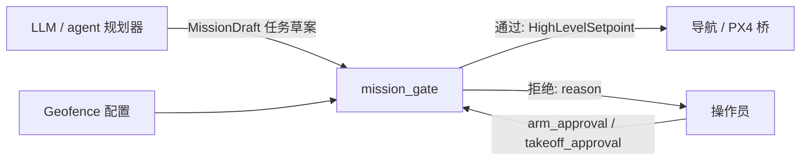

# 任务层 Agent 设计 Task / Agent Layer

本文档由 Grok 撰写/协助；2026-11-11 由 Claude 按实际实现更新。

任务层把「去测绘这个区域并回来」这类自然语言或地面任务，变成可执行、可拒绝的高层任务。它是规划器，**不是**飞控。

Ryan 原代码已丢失；本文件与 `hummingbird_task_agent` 都是全新草图，未在硬件上验证。

## 职责划分

- **LLM / agent**：解释地面任务、提出航点或区域、标注任务类型（探索、测绘、观察、悬停、返航、降落）。可以建议「需要解锁才能执行」，但**不能自己把批准位置为 true**。
- **mission_gate**：检查 geofence、任务完整性、以及解锁 / 起飞的显式人工批准。通过后只发布 `HighLevelSetpoint`。
- **导航与 PX4**：跟踪已放行的 setpoint，并执行 PX4 自己的 failsafe。

## 硬性安全规则

1. **Agent 不得直接发送执行器指令。** 禁止发布或调用：电机 / 舵机 PWM、混控输出、`actuator_motors` / `actuator_servos` 一类话题、绕过 PX4 的 OFFBOARD 直接改执行器、以及任何「未经过门控的」`VEHICLE_CMD_COMPONENT_ARM_DISARM` 或等价解锁命令。
2. **解锁（arm）与起飞（takeoff）必须有人工显式批准。** `RequestMission.arm_approval` 与 `takeoff_approval` 默认为 `false`。未置位时，门控必须拒绝相应动作，并返回原因。批准只对这一次请求有效，不能变成会话级的「永远允许」。
3. **Geofence。** 每个航点和 setpoint 都要落在水平范围与最大高度之内（高度相对 `home_xyz`，站点上限写在 `hummingbird_task_agent/config/mission_gate.yaml`，目前全是占位数值）。越界则整个任务拒绝，而不是默默裁剪到边界上——默默裁剪会让操作员误以为原任务已被接受。**请求里带的 geofence 只能收紧站点上限，不能放宽**；速度上限同理，超过就拒绝。坐标里有 NaN / 无穷大也拒绝。
4. **拒绝要可解释。** 响应里的 `reason` 需写明是缺少批准、越界、坐标系未知，还是任务类型不支持。每次裁决还会在 `/hummingbird/status` 发一条 JSON，带机器可读的 `code`（如 `needs_arm_approval`、`outside_geofence`、`pending_approval`）。
5. **Failsafe 优先。** PX4 的失联、低电量、geofence 故障保护优先于任务层。门控不得屏蔽 RTL / 杀油门等安全开关。实现上，`rtl` 和 `land` 请求**无条件放行**：不需要批准位、不需要 `frame_id`、不查 geofence，连 `mission_id` 为空也照样接受。

## 请求到放行的流程

两个入口，同一套校验：

**A. 服务 `/hummingbird/mission/request`（批准位随请求一起给）**

1. 门控检查：非空 `mission_id`、已知 `mission_type`、航点坐标系可接受、全部航点在 geofence 内。
2. 若任务需要解锁或离地：检查 `arm_approval` / `takeoff_approval`。缺一则 `accepted=false`，并且**不**发布 setpoint。
3. 通过后，节点按顺序发布 `HighLevelSetpoint`。

**B. 话题 `/hummingbird/ground/task`（`GroundTask`，不带批准位）**

地面机器人或规划器不能批准自己的任务，所以 `GroundTask` 消息里故意没有批准字段。

1. 任务是 `rtl` / `land`：立即放行。
2. 其它任务先做除批准以外的全部检查。不合格直接拒绝；合格则作为**草案**挂起，并在 `/hummingbird/status` 报 `pending_approval`。
3. 操作员调用 `/hummingbird/mission/approve`（`ApproveMission`：`mission_id` + 两个批准位）。节点把批准位填进草案，**重新跑一遍完整校验**，通过才发布。
4. 一次批准只对这一份草案有效，不会被记住：批准不全会被拒绝并保留草案，批准通过则草案被消耗。草案 `draft_ttl_s`（默认 120 s）内没人批准就过期。

**放行之后**

- 一次任务的 N 个航点发成 N 条 `HighLevelSetpoint`，带 `sequence`（0…N−1）和 `total`，消费者必须收齐才能开始；新的 `mission_id` 取代旧任务。
- 每条带 `action`（GOTO / LOITER / RTL / LAND）、可选偏航（`yaw_valid`）和可选速度上限。`rtl` / `land` 是一条只有动作的消息。
- 话题是 VOLATILE 的：晚启动的消费者收不到以前放行的任务，避免重放一份过期的批准。
- 节点不发布 arm 指令；是否真正解锁由操作员在地面站 / QGC 侧完成。骨架节点**不会**调用 PX4 解锁接口，这是有意留空，避免「有一个可以解锁飞机的 Python 节点」在无人看管时被误用。

**批准位不是安全边界。** 没有启用 SROS2 的 ROS 2 网络上，任何节点都能调这两个服务、把批准位写成 true。它是流程上的闸门，防的是误操作和"模型顺手就批了"，防不了恶意节点。真正的硬约束是：这个工作空间里没有任何代码能解锁飞机，解锁权始终在飞手的遥控器 / QGC 上。

## 与 LLM 的接口建议

把模型输出限制为结构化草案，例如：`mission_type`、`waypoints`、`frame_id`、`geofence_max_altitude_m` 建议值、自然语言 `description`。然后将草案填进 `RequestMission`，批准位只由 UI 或硬件开关写入。不要让模型直接调用 ROS 2 CLI 去 `ros2 topic pub` 飞控话题。

## 骨架实现范围

`hummingbird_task_agent` 提供：

- `mission_gate.py`：纯函数校验（无 ROS 依赖）`evaluate_mission(...)`
- `mission_flow.py`：草案 / 批准流程和 setpoint 展开（无 ROS 依赖）
- `mission_gate_node.py`：ROS 2 节点，提供 `RequestMission` 与 `ApproveMission` 服务，订阅 `GroundTask`，发布 `/hummingbird/task/setpoint_request` 与 `/hummingbird/status`
- `config/mission_gate.yaml`：站点 geofence、原点、速度上限、允许的坐标系

未实现（有意为之）：自动解锁、自动起飞、实机 geofence 多边形、模型推理、与 `px4_msgs` 的直接执行器连接。

**未实现（还没做）：`HighLevelSetpoint` 的消费者。** 放行的 setpoint 目前没有任何节点去执行，包括 `rtl` / `land`。返航和降落现在只能靠飞手或 PX4 自己的故障保护。

## 尚未验证

- 未在 Jetson 或 Pixhawk 上运行（单测和进程内 ROS 测试在云端 ROS 2 Jazzy 上通过）。
- 未与 QGroundControl 的 arm 流程对接。
- Geofence 默认数值只是开发占位，部署前必须改成场地实测范围。
- geofence 在请求自带的坐标系里直接判断，所以 `allowed_frames` 里列出的坐标系必须与 `home_xyz` 同原点、同朝向；目前没有做 TF 变换。
