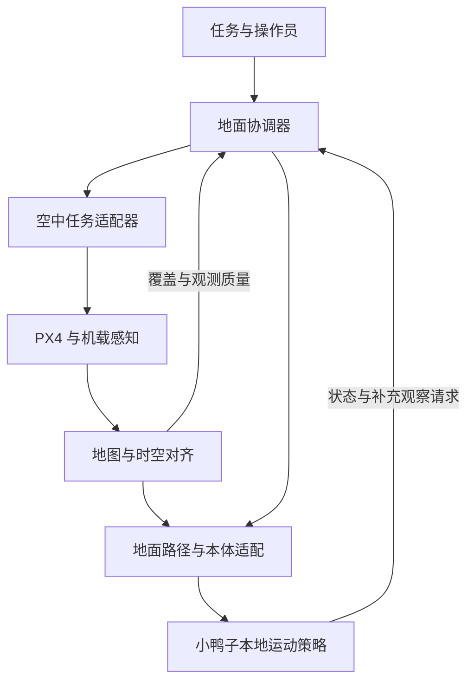

# Oprace 白皮书 v0.2

## 面向移动智能体的空地协同感知与行动

**研究与工程草案 · 2026 年 11 月 11 日**

本文将 Oprace 的协同系统设想具体化为“蜂鸟 Hummingbird 无人机＋Open Duck Mini 双足机器人”的首个验证方案。蜂鸟保留为空中节点项目，本仓库承载其实现与空地接口；Oprace 表示跨平台的协同研究方向。

**版本说明：**v0.2 是文档版本，承接本仓库《蜂鸟 Hummingbird 白皮书 v0.1》，不代表软件已经发布到 v0.2。本文区分当前代码、上游能力和拟议工作；所有实验方案与指标均为计划，尚无本项目空地协同实测结果。

## 1. 摘要

Oprace 希望让移动中的智能体获得超出自身视角的环境信息，并把这些信息转化为更可靠的行动。无人机可以主动改变观察位置，地面机器人可以提供接近地面的局部信息；双方围绕同一个任务交换所需信息，而不是持续传输全部传感器数据。

首个验证系统由一架蜂鸟建图无人机、一台 Open Duck Mini 双足机器人和一台地面协调计算机组成。无人机观察前方区域并提供地图增量，地面机器人结合自身位置、局部感知与运动能力重新选择路线。遇到盲区、地图过期或定位不确定时，地面端可以请求补充观察，或者在本地停止继续前进。

本项目首先研究一个可测量的问题：**在相同场景与资源约束下，按任务需要调度空中观察，能否提高地面机器人到达目标的成功率，并减少无效探索与通信开销？** 无人机能飞、小鸭子能走、两端能通信，是这一研究的前提；它们并不直接构成协同效果的证据。

长期目标是将同一套任务、地图和能力描述接口扩展到不同移动平台。双足小鸭子是初期研究载体，其运动限制会被明确建模；换成轮式机器人或其他平台时，需要替换本体适配器并重新验证。

## 2. 项目基础与当前状态

截至本次核查，本仓库的基线为提交 [1091eef](https://github.com/lucascygu/hummingbird-mapping-drone/commit/1091eef593d11072066147fedb93d1abbd8872c3)。

| 对象 | 已有依据 | 仍需完成 |
| --- | --- | --- |
| 蜂鸟仓库 | 架构文档、ROS 2 消息与服务定义、任务闸门骨架 | 重建完整工作空间，完成编译、集成与实机验证 |
| 历史建图工程 | 参考报告记载过飞行与激光建图工作 | 原工程代码按当前 README 已丢失，不能视作已导入的可运行系统 |
| Open Duck Mini | 已有硬件设计、运行时与训练环境的上游项目及账号下 fork | 确认实物版本、传感器、已训练策略和本机运行状态 |
| 空地协同 | 当前仓库有接口草图和若干数据结构 | 坐标对齐、地图生成与消费、地面定位、运动适配、闭环实验 |
| 合作研究 | 小鸭子与无人机协同是当前拟议方向 | 共同确认分工、实验资源、成果署名与数据共享范围 |

无人机目标栈沿用 **Pixhawk 6C / PX4、Jetson、Livox Mid-360、ROS 2、FAST-LIO2 的 ROS 2 移植**。参考报告中的 Orin Nano Super 8GB、ROS 2 Humble 等配置属于历史报告记录；本次重建实际使用的 Jetson 型号、镜像、ROS 2 版本和驱动组合仍须重新核实。

“小鸭子”在本文中指 **Open Duck Mini 双足平台**。其上游运行脚本使用本机传感器与 ONNX 策略生成关节目标，所核查脚本的控制频率默认值为 50 Hz。这是代码默认值，不是本项目已经测得的实时性能，也不证明机器人具备自主导航能力。[S2]

## 3. 研究问题与预期产出

### 3.1 三个研究问题

1. **何时值得请求空中观察？** 地面路线受遮挡、地图陈旧或位置不确定时，补充观察带来的任务收益，是否足以补偿飞行时间、能量和通信成本？
2. **共享什么信息足够支持行动？** 比较原始点云、局部高度 / 占用地图、任务相关风险摘要，确定在不同带宽条件下的收益与损失。
3. **如何把空中信息变成双足平台可执行的路线？** 空中看到空地不等于小鸭子能够通过，需要结合支撑面、通道宽度、坡度、台阶及本体经过验证的运动范围。

这三项是研究假设与工程问题，本文不宣称已经证明性能优势或学术首创性。正式论文还需要针对具体算法补充相关工作检索、可复现实验和同行比较。

### 3.2 预期产出

- 一个“请求观察—生成地图增量—地面改道—结果反馈”的可复现演示。
- 一套区分任务、地图、定位质量和本体能力的接口规范。
- 可回放的数据、配置与实验记录，以及明确包含失败情况的评测报告。
- 对新增无人机是否值得的量化结论；若收益不足，也应给出适用边界。

初期优先使用确定性调度与已有运动策略。大模型、多智能体学习和复杂分布式训练可在基线成立后加入，并通过消融实验说明各自贡献。

## 4. 最小验证场景

首个场景采用已知边界内的低速地面路线选择：小鸭子从起点前往目标，途中存在局部遮挡、分叉或被障碍物阻断的候选通道。无人机从预先限定的观察位置补充环境信息，地面端据此选择下一段路线。

这里的“观察遮挡区域”是通过改变传感器视角实现的。机体安装方向、雷达视场和实际可见表面决定观测能力；不能假设激光雷达能穿透障碍，也不能把未观测区域直接判为可通行。

验证按以下闭环进行：

1. 地面端生成候选路线，标出未知或需要更新的区域。
2. 协调器判断是否需要支援，生成包含区域、用途和有效期的观察请求。
3. 无人机在已批准的任务边界内完成观察，输出带坐标、时间与质量信息的地图更新。
4. 地面端校验地图与自身定位，生成满足本体限制的下一段路径。
5. 本地运动适配器将路径转成受限的运动目标，由小鸭子自己的运动策略执行。
6. 地面端记录实际进展、地图误差和失败原因，必要时再次请求观察。

初期每次只执行短距离地面动作，并保留人工中止。离线点云回放、固定传感器采集与分开运行的仿真先用于打通接口；只有在无人机和小鸭子都实际参与同一次闭环后，才将其记为联合实机实验。

## 5. 系统架构与控制边界

下图是目标架构，连线表示待实现或待验证的数据流，不表示当前仓库已完成连接。

### 5.1 各端职责

| 节点 | 主要职责 | 需要本地持续具备的能力 |
| --- | --- | --- |
| 无人机飞控 | 飞行控制、状态估计与配置好的失效处理 | 飞行稳定与本机故障响应 |
| 无人机伴随计算机 | 传感器驱动、LIO、地图处理、任务适配 | 资源监测、任务过期检测与数据记录 |
| 小鸭子计算单元 | 本体状态、运动策略、受限指令接收 | 平衡控制、指令超时处理与经过验证的停止行为 |
| 地面协调计算机 | 任务安排、地图服务、实验记录与可视化 | 调度与记录；不接管本体高速控制闭环 |

小鸭子的高级定位与路径规划可以先放在地面计算机运行，本机保留运动闭环。这种配置必须写进实验设置，其通信延迟也必须计入结果。

### 5.2 独立控制闭环

PX4 继续承担飞行控制，小鸭子的既有运行时继续承担关节级运动控制。跨设备通信主要传递任务、地图、状态以及受限的运动目标。地面协调器中断时，双方应按本机状态进入各自经过验证的退化行为。

对于双足机器人，“停止”不能简单解释为立即断开全部关节力矩。应根据本体策略实现并验证减速、站稳、保持或人工接管等行为。零速度输入也需要实际验证，不能仅靠接口字段推定安全。

Nav2 可以作为地图、全局路径或行为树的候选工具，但接入前需要专门适配。它不自动提供小鸭子的平衡控制或足步规划，也不能直接替代无人机的三维轨迹规划和飞控。

### 5.3 地图服务与地面定位

FAST-LIO2 的位姿与点云输出只是地图服务的输入。可供地面机器人使用的地图还需要坐标变换、地面 / 障碍分离、栅格化、质量评估及更新管理。

小鸭子的 IMU 和运动策略输入不能直接视作可靠的全局位置。初期必须选定一种可验证的地面定位方案，例如经过标定的外部视觉定位，或后续增加并验证的本体视觉 / 深度定位。额外设备的成本、遮挡和失效条件都要计入实验。

无人机的运行高度、传感器朝向和观测距离应通过实际覆盖试验确定。地面机器人附近的飞行距离还要考虑旋翼气流对其姿态的影响；首个演示可在观察与行走之间分阶段执行，减少耦合因素。

## 6. 时空对齐与可通行性

### 6.1 共同坐标与时间

共享一张地图至少需要共同参考系、可追溯的变换和时间语义：

- 为一次实验定义共同任务坐标系；记录无人机地图、小鸭子局部坐标系与任务坐标系之间的变换。
- ROS 与 PX4 的坐标约定在适配层显式转换并核对，不能把 ENU / FLU 数值原样当作 NED / FRD。
- 地图携带观测时间和地图版本；接收时间不能代替观测时间。
- 记录时钟偏差或同步误差。相对定位方法必须说明公共锚点、标定步骤与误差。
- LIO 重启或重定位造成原点变化时，应切换地图 epoch；旧坐标的地图和任务不得混用。

GNSS、标记物或点云配准都是可能手段，首个实验只需选择其中可可靠验证的组合，不必同时实现全部方案。

### 6.2 从几何地图到机器人可行路线

为每种地面平台维护一份经过实验确定的能力描述，包括外形余量、允许速度、转弯约束，以及已验证地形范围。对小鸭子，初期可以只接受平整地面和足够宽的通道，其余地形保持未知或不可执行。

高度、坡度和障碍尺寸从地图估计；摩擦、松软地面或真实承重能力通常不能仅由几何地图可靠推出。对这类属性不应生成没有依据的确定结论。外部地图提供前方信息，本地感知和运动状态继续决定当前动作能否执行。

接收方至少校验地图时效、坐标一致性、定位质量、观测覆盖和本体能力。无法满足条件时，应请求更新、缩短动作距离或停止继续前进。

## 7. 现有接口与拟议扩展

### 7.1 当前仓库实际存在的结构

| 当前文件 | 已定义内容 | 尚不能由此推定的能力 |
| --- | --- | --- |
| [GroundTask.msg](../ros2_ws/src/hummingbird_interfaces/msg/GroundTask.msg) | 任务 ID、类型、描述、坐标系、航点与围栏数值 | 名称含 Ground 不表示已有地面运动控制器或自动支援调度 |
| [MapTile.msg](../ros2_ws/src/hummingbird_interfaces/msg/MapTile.msg) | 地图块 ID、类型、分辨率、尺寸、原点与整型数组 | 尚缺完整编码语义、质量信息、地图 epoch 与过期规则 |
| [HighLevelSetpoint.msg](../ros2_ws/src/hummingbird_interfaces/msg/HighLevelSetpoint.msg) | 位姿、任务 ID、坐标系、速度限制等 | 不能直接用作小鸭子的关节或步态指令 |
| [RequestMission.srv](../ros2_ws/src/hummingbird_interfaces/srv/RequestMission.srv) | 高层任务请求、批准布尔字段、接受结果与原因 | 布尔字段本身不提供可信授权或端到端执行保障 |

现有话题与服务草图见 [空地协同接口文档](air-ground-cooperation.md)。发布端、订阅端、地图处理器与执行桥接仍需逐项实现和验证。

### 7.2 下一阶段的接口提案

以下名称是设计提案，**当前仓库尚无相应消息文件**。实现时可以扩展现有接口，也可以新增版本化消息，但不能静默改变旧字段含义。

| 拟议接口 / 语义 | 最低必要信息 |
| --- | --- |
| ObservationRequest | 请求 ID、目标区域、任务坐标系、观察用途、优先级、截止时间、预算 |
| TerrainTile / RiskTile | 地图 epoch、序号、观测时间、有效期、分辨率、质量、未知单元与数值编码规则 |
| GroundMotionRequest | 本体 ID、局部参考系、短程目标或速度目标、速度上限、有效期 |
| RobotState / Capability | 定位质量、任务状态、当前故障、可执行动作范围及能力描述版本 |
| TaskResult | 对应请求、接受 / 执行 / 完成 / 拒绝状态、原因、所用地图版本与实际进展 |

先明确 `MapTile.data` 的单位、缩放和未知值，保证数组长度与尺寸一致；对同时出现的 `header.frame_id` 与 `frame_id` 规定一致性检查。地图中的未知区域与自由区域必须区分。

运动适配器需要校验输入单位、方向、限幅、有效期和控制权。Open Duck Runtime 已有命令输入不等于已有适用于协同网络的认证、看门狗或可靠传输服务，不能直接把调试入口当作产品接口。

## 8. 通信、算力与任务安排

### 8.1 首期通信方案

首期使用本地网络与一个地面协调节点，先建立可观察、可重放的端到端数据流。节点各自记录原始传感器数据；在线传输优先考虑任务附近的地图增量、状态和风险信息。

| 数据层级 | 处理策略 | 评测重点 |
| --- | --- | --- |
| 紧急状态、任务取消与控制状态 | 小消息优先，执行端独立检查有效期 | 时延、丢包与过期指令拒绝 |
| 本体状态与任务进度 | 限定频率，优先最新状态 | 状态陈旧程度与调度误判 |
| 局部地图与风险更新 | 按区域、变化量和任务需要发送 | 地图年龄、覆盖、带宽及路径收益 |
| 原始点云与图像 | 本地记录为主，按需回传片段 | 记录完整性及离线可复现性 |

可靠传输也可能积压过时数据，因此控制和地图消费者都需要应用层的有效期检查。ROS 2 的 QoS 配置应按消息用途分别测试。

Zenoh 等传输中间件可在跨网段、弱连接或多节点需求明确后评估；它不替代物理无线链路。KubeEdge 可作为未来多设备部署管理的候选，不能代替机器人感知、导航和运动控制。首期不将二者设为完成协同演示的前置依赖。

### 8.2 算力分配原则

优先保证本体控制和实时感知的资源，再安排地图处理、规划和任务模型推理。记录 CPU / GPU 负载、内存、温度及推理时延，避免高层任务挤占底层控制。

初期只做任务级分工：无人机处理机载观测，小鸭子执行本地运动，地面端处理协调与较重的地图分析。分布式模型训练、跨节点推理拆分和大规模集群调度属于后续研究，不是当前仓库已有能力。

### 8.3 请求空中支援的规则基线

第一版可采用可解释的触发条件：候选路径经过未知区域、关键地图超过有效期、预定通道被阻断，或地面定位质量下降。调度器比较可用观察位置、预计等待时间与剩余任务预算，决定观察、等待、改道或拒绝请求。

后续可以学习“什么信息最值得获取”，但应保留同一套规则基线。大模型若加入，主要承担任务解释、候选方案与结果说明；输出必须转成有明确字段的请求，并由确定性组件检查。

## 9. 权限、失效处理与可审计性

现有 [mission_gate.py](../ros2_ws/src/hummingbird_task_agent/hummingbird_task_agent/mission_gate.py) 对任务类型、坐标系、批准字段和部分围栏条件进行检查。它是规则骨架，尚不能证明任意模型输出或其他 ROS 节点都无法绕过控制边界。

正式接入前需要明确操作员身份、授权来源、命令入口和执行端权限。模型不能自行签发飞行批准；执行端应拒绝失效或未经授权的请求。批准范围需要绑定具体任务、设备、时间与空间边界，而不能仅依赖请求方填写一个布尔值。

| 故障或异常 | 设计要求 |
| --- | --- |
| 地图过期、缺失或坐标不一致 | 地面端拒绝据此继续执行，保留原因并请求更新 |
| 地面定位失效 | 停止接收新的路径段，进入已验证的本体处置流程 |
| 数据链断开或协调器退出 | 本体按本地超时策略处置；无人机按配置和当前飞行条件执行失效策略 |
| 任务模型超时或无效输出 | 拒绝请求或回到规则调度，记录原因 |
| 地图原点变化 | 旧地图 / 路径作废，重新对齐后再恢复 |
| 电量不足或温度异常 | 停止分配新任务，转入对应平台的恢复或结束流程 |

所有表中行为都是待实现与待验证的系统要求。围栏默认数值和示例配置不能直接当作实际场地参数。日志至少关联任务 ID、授权记录、观测时间、地图版本、坐标变换版本、控制请求与执行反馈。

## 10. 实验设计与评价方法

### 10.1 主比较

| 组别 | 信息与调度方式 | 要回答的问题 |
| --- | --- | --- |
| B0：地面独立 | 相同地面感知、定位和运动栈，不使用空中信息 | 基准表现如何 |
| B1：固定空中支援 | 无人机按预设观察计划更新地图 | 增加空中观察本身带来多少收益 |
| B2：按需空中支援 | 地面状态触发观察请求与局部信息回传 | 任务驱动协同是否优于固定支援 |

B1 与 B2 使用相同硬件、共同的最大飞行时间 / 能量和通信预算。B0 不需要虚构无人机消耗；三组均记录实际使用的全系统资源，从而判断新增空中节点的收益是否抵得过成本。

场景、起终点、障碍配置、地面软件版本与传感器条件保持一致，实验顺序随机或交错。仿真使用可复现种子；实机记录电池状态、场地变化和设备重置条件。标定场景、调参场景与正式评测场景分开。

### 10.2 指标

| 类别 | 指标与记录方法 |
| --- | --- |
| 任务效果 | 到达成功率、超时率、完成时间、行进距离、回退次数 |
| 本体运行 | 跌倒、碰撞、人工接管、急停及其触发原因；报告次数与暴露时长 |
| 定位与地图 | 对共同参考的定位误差、对齐误差、关键区域覆盖率、地图观测年龄 |
| 信息时效 | 从观测到地面采用该地图的端到端时延，报告中位数与 P95 |
| 通信 | 实际字节数、峰值 / 平均吞吐、丢包、积压和过期消息拒绝次数 |
| 资源 | 各设备能量消耗、运行时间、计算负载与热降频情况 |

成功必须同时满足到达目标、未触发预定失败条件、未超出预算；超时、跌倒和人工完成任务均不能算作自主成功。

初步计划在仿真中每个场景每组进行不少于 30 次重复，作为试验起点而非统计充分性的保证。根据试点方差与预期效果确定正式样本量；实机先做小规模分阶段验证，再决定重复次数。报告实际样本量、全部失败、效应大小和置信区间，不预填成功率或提升百分比。

### 10.3 消融与故障注入

在主比较成立后，分别比较完整点云、地图块和任务相关摘要；比较不同地图更新频率与观察触发条件。延迟、丢包、坐标偏差和地图过期优先在回放或仿真中注入，检查系统何时失去收益、何时应拒绝继续执行。

共享地理场景与统一时钟需要专门构建。PX4 仿真和 Open Duck 的 MuJoCo 环境分别能运行，不代表二者已构成统一的空地联合仿真。涉及旋翼气流等物理交互时，还需要额外模型或实测验证。

## 11. 实施路线与验收条件

以下用阶段编号表示工作顺序，不对应已发布的软件版本，也不承诺完成日期。

| 阶段 | 主要交付物 | 进入下一阶段的条件 |
| --- | --- | --- |
| P0：核实与重建 | 硬件清单、环境锁定、代码来源、标定与日志规范 | 两个平台的实际配置可复查，重建范围明确 |
| P1：各端独立运行 | 蜂鸟感知 / 仿真工作空间；小鸭子本地运动与超时处置 | 各端分别可重复运行，记录资源和故障行为 |
| P2：回放协同 | 共同坐标、地图编码、地面定位、请求与反馈记录 | 回放地图能改变路线，陈旧与错误坐标数据被正确拒绝 |
| P3：仿真实验 | B0 / B1 / B2 场景与自动化评测脚本 | 可复现实验结果，能够解释失败与资源开销 |
| P4：有限实机闭环 | 分阶段观察、低速短程运动与人工中止 | 完成真实“观察—改道—反馈”，具备完整日志 |
| P5：扩展验证 | 更多场景、平台或学习型调度 | 对比基线仍有收益，明确每种扩展的适用边界 |

最先需要补齐的是地面定位、地图编码与小鸭子运动适配，而不是增加更多调度框架。无人机完整建图工程的重建也必须有独立验收，不能被接口演示替代。

## 12. 合作方式与开源资源

### 12.1 拟议合作工作包

当前合作仍处于探索阶段。以下是建议拆分，负责人、署名和交付时间需参与者共同确认，不代表已达成分工承诺。

| 工作包 | 核心产出 | 与其他工作的交界 |
| --- | --- | --- |
| 空中平台 | 重建工作空间、标定、LIO 与观测任务 | 提供带质量与时间信息的地图输入 |
| 小鸭子平台 | 实物与策略核实、本地控制、定位及能力测量 | 提供可执行动作边界与状态反馈 |
| 协同与地图 | 坐标对齐、地图更新、请求调度、本体适配 | 连接观察信息和地面行动 |
| 实验与复现 | 场景、基线、数据记录、统计与演示 | 用共同指标判断各模块是否形成收益 |

合作初期先共同确认设备归属与可用时间、工作场地、数据记录范围，以及哪些代码和实验结果可以公开。项目发起、硬件支持、软件开发和研究贡献应分别记录，避免将“参与讨论”自动写成“共同作者”。

### 12.2 优先复用的 GitHub 资源

| 资源 | 在本方案中的用途 | 接入边界 |
| --- | --- | --- |
| [Hummingbird](https://github.com/lucascygu/hummingbird-mapping-drone) | 空中工程与协同接口的当前承载仓库 | 仍是重建中的文档与骨架 |
| [Open Duck Mini](https://github.com/apirrone/Open_Duck_Mini) · [本账号 fork](https://github.com/lucascygu/Open_Duck_Mini) | 双足平台硬件与设计入口 | 以实物版本核对 BOM、关节与传感器 |
| [Open Duck Mini Runtime](https://github.com/apirrone/Open_Duck_Mini_Runtime) · [fork](https://github.com/lucascygu/Open_Duck_Mini_Runtime) | 本地策略推理与硬件运行 | 需要协同命令适配、超时处理与权限约束 |
| [Open Duck Playground](https://github.com/apirrone/Open_Duck_Playground) · [fork](https://github.com/lucascygu/Open_Duck_Playground) | 运动策略训练与仿真参考 | 训练结果需匹配本体，不能推定实机地形能力 |
| [PX4](https://github.com/PX4/PX4-Autopilot) · [px4_ros_com](https://github.com/PX4/px4_ros_com) · [px4_msgs](https://github.com/PX4/px4_msgs) | 飞控与 ROS 2 接口 | 锁定兼容版本，核对坐标与命令入口 |
| [livox_ros_driver2](https://github.com/Livox-SDK/livox_ros_driver2) · [Livox-SDK2](https://github.com/Livox-SDK/Livox-SDK2) | 雷达接入 | 时间同步、外参与驱动版本需验证 |
| [FAST_LIO_ROS2](https://github.com/Ericsii/FAST_LIO_ROS2) · [原始 FAST_LIO](https://github.com/hku-mars/FAST_LIO) | 激光惯性定位与建图基础 | 后续地图融合、可通行性与地面定位另行实现 |
| [Nav2](https://github.com/ros-navigation/navigation2) | 候选路径规划与任务组件 | 需双足本体适配；不承担平衡或飞控 |
| [Newton](https://github.com/newton-physics/newton) | 后续物理仿真研究候选 | 不是首个闭环的必选项，也未接入本仓库 |

原创建模文档与骨架沿用本仓库许可，上游代码与素材分别保留其许可。fork 的存在不表示代码已经集成，也不表示所有仓库采用相同许可证；复用前以所选提交的许可文件为准。具体记录见 [README 的许可说明](../README.md#许可)。

## 13. 当前必须确认的事项

1. 小鸭子的实际版本、计算板、传感器、可用策略，以及是否已经完成稳定行走验证。
2. 蜂鸟本次重建的机架、计算模块、镜像、ROS 2 发行版、标定和可恢复代码范围。
3. 地面机器人如何定位；共享坐标如何建立；所选传感器能否覆盖实验关键区域。
4. 第一场实验的场地、目标任务、动作范围、资源预算与失败判据。
5. 合作双方承担的工作包、可提供的设备、时间安排和成果公开方式。

这些信息会影响具体实现，不妨碍先完成消息语义、数据回放和实验脚本设计。未确认参数应保留为配置项，并在实验开始前固定与记录。

## 14. 依据与版本记录

### 14.1 核查依据

- **[S1] 当前仓库基线：**[README](https://github.com/lucascygu/hummingbird-mapping-drone/blob/1091eef593d11072066147fedb93d1abbd8872c3/README.md)、[原 v0.1 白皮书](https://github.com/lucascygu/hummingbird-mapping-drone/blob/1091eef593d11072066147fedb93d1abbd8872c3/docs/whitepaper.md)、[接口目录](https://github.com/lucascygu/hummingbird-mapping-drone/tree/1091eef593d11072066147fedb93d1abbd8872c3/ros2_ws/src/hummingbird_interfaces)、[任务闸门](https://github.com/lucascygu/hummingbird-mapping-drone/blob/1091eef593d11072066147fedb93d1abbd8872c3/ros2_ws/src/hummingbird_task_agent/hummingbird_task_agent/mission_gate.py)。它们用于确认当前实现范围。
- **[S2] 小鸭子运行时：**[Open Duck Mini Runtime](https://github.com/lucascygu/Open_Duck_Mini_Runtime/tree/v2) 与 [v2_rl_walk_mujoco.py](https://github.com/lucascygu/Open_Duck_Mini_Runtime/blob/v2/scripts/v2_rl_walk_mujoco.py)。本次读取的脚本 blob SHA 为 `530ebb97c465385d3e047b2161e8350358a58152`；分支后续可能变化。
- **[S3] 本体与训练环境：**[Open Duck Mini v2](https://github.com/apirrone/Open_Duck_Mini/tree/v2)、[Open Duck Playground](https://github.com/apirrone/Open_Duck_Playground)。用于确认平台类型与已有工具，不作为本项目实验结果。
- **[S4] 历史工程资料：**用户提供的《3D Mapping And Modeling Drone System》（文件名 `slam雷达无人机项目报告.pdf`；报告作者 Ryan Zhang、Shang-pin Chen、Xin Gao、Haoling Wang）。仅作为历史硬件与建图方案参考，未随本文上传报告原件；当前工程可用性以重建仓库为准。

核查日期为 2026 年 11 月 11 日。本文的研究设计、扩展接口、调度方法与验收条件是拟议工作，不应读作上述上游项目已经提供的能力。

### 14.2 文档变更

| 版本 | 日期 | 范围 |
| --- | --- | --- |
| 蜂鸟白皮书 v0.1 | 2026-11-11 | 空中节点、建图栈、任务门控与概括性协同设想 |
| Oprace 白皮书 v0.2 | 2026-11-11 | 明确 Oprace / 蜂鸟 / 小鸭子关系；补充地面定位、运动适配、时空对齐、通信预算、实验基线与阶段验收 |

本版本的首要交付目标，是证明空中新增的信息能够改善地面行动，并完整记录为此付出的计算、通信、能量与工程成本。
