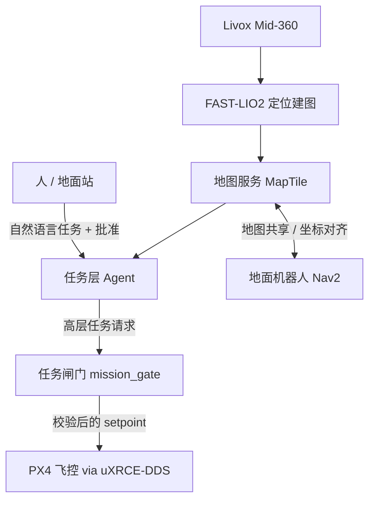

# 蜂鸟 Hummingbird 白皮书 v0.1
**会建图、会思考的空中具身智能节点**

2026 年 11 月 · 草案

## 1. 摘要
蜂鸟是一个开源的三维建图无人机平台：Pixhawk 6C 跑 PX4 负责飞控，Jetson 负责机载计算，Livox Mid-360 激光雷达负责感知，在 ROS 2 上用 FAST-LIO2 做实时定位和建图。我们的目标是把它从"会飞的扫描仪"升级成**具身智能空中节点**：它能理解人用自然语言交代的任务，能和地面机器人共享地图、分工协作，同时所有涉及安全的决定都留在可验证的规则和人的批准里。

## 2. 要解决的问题
- 现在的建图无人机大多"飞完再处理"，现场看不到地图，也没法根据地图改任务。
- 空中和地面的机器人各建各的图，坐标系对不上，没法分工。
- 大模型 agent 能理解任务，但让它直接控制电机是不安全的。

## 3. 系统架构

系统分五层：
1. **飞控层**：PX4 负责姿态、位置控制和失控保护，是最后一道安全防线。
2. **感知层**：Mid-360 提供 360° 的激光点云，再配合 IMU 数据。
3. **定位建图层**：FAST-LIO2 实时输出位姿和点云地图。
4. **导航层**：规划航点和避障，地面端用 Nav2。
5. **任务层**：大模型 agent 把任务拆成高层目标，但只能发"请求"，不能直接下控制指令。

## 4. 核心创新
### 4.1 任务闸门
agent 和飞控之间隔着一个确定性的闸门节点，规则是：
- 没有人工批准（`arm_approval`）就不能解锁、不能起飞；
- 超出电子围栏的请求直接拒绝；
- 只接受高层 setpoint，不接受电机或姿态指令。

就算 agent 出错，也越不过这几条底线。

### 4.2 空地协同
无人机从空中快速建出大范围地图，切成 `MapTile` 地图块发给地面机器人。地面机器人用 Nav2 做精细导航，再通过 `GroundTask` 回传需要空中支援的任务。双方要先对齐坐标系，方法是用共同的锚点或者做点云配准。

### 4.3 具身智能节点
无人机不只是工具，而是网络里一个会感知、会决策、会汇报的节点。它可以接受多个 agent 调度，也能跟 Paperclip 这类多模型编排系统对接。

## 5. 开源生态
蜂鸟站在这些开源项目的肩膀上，都已经 fork 到 lucascygu 账号下存档：FAST_LIO_ROS2（GPL-2.0）、livox_ros_driver2、Livox-SDK2、Nav2、PX4-Autopilot、px4_ros_com、px4_msgs。腿式机器人方向的参考是 Open Duck Mini 和 Newton 物理引擎。蜂鸟自己的原创代码用 MIT 许可证，各个 fork 保留原来的许可证。

## 6. 路线图
- **v0.1（现在）**：架构文档、ROS 2 接口定义、任务闸门骨架。
- **v0.2**：Ryan 的重建代码合进来，能在仿真里跑通建图（PX4 SITL 加 Gazebo）。
- **v0.3**：真机飞行建图，地图实时回传到地面站。
- **v0.4**：空地协同演示，无人机建的图交给地面机器人导航。
- **v1.0**：用自然语言下达任务，闸门全程把关，有完整的日志可以审计。

## 7. 安全与合规
飞行要遵守当地法规，美国要守 FAA Part 107 的规定。测试按先仿真、再系留、再开阔场地的顺序推进。agent 永远拿不到直接控制电机的权限。

## 8. 团队
Lucas（发起人），Ryan（飞行平台与建图），ian-robotics（已受邀加入）。

## 待核实
Jetson 的具体型号、ROS 2 用哪个发行版、雷达外参，还有电子围栏的默认数值，现在都只是占位。代码没有编译过，也没上过硬件。
